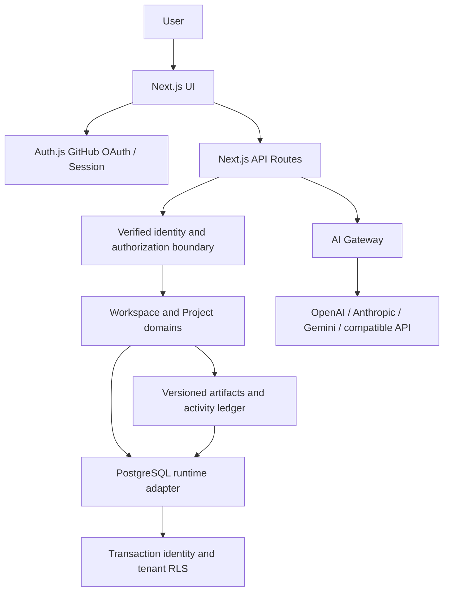

# SynqForge

**From idea to industry.**

SynqForge is an early-stage product creation and lifecycle workspace for founders and product teams. Its current implementation provides authenticated workspaces, project management primitives, versioned project artifacts, and consent-gated AI-assisted PRD drafting.

> **Project status:** This repository contains an implemented foundation—not a complete autonomous software factory. Product discovery, design generation, code/build orchestration, GitHub repository operations, and deployment lifecycle automation remain roadmap work. Live OAuth, live AI-provider, and fully authenticated deployed cross-tenant browser verification are not represented as complete unless separately run and confirmed.

[](https://github.com/ReignnRule11/Synqforge-/actions/workflows/ci.yml)

- **Repository:** [ReignnRule11/Synqforge-](https://github.com/ReignnRule11/Synqforge-)
- **Hosted URL:** [synqforge-sigma.vercel.app](https://synqforge-sigma.vercel.app) (deployment URL; runtime behavior depends on its environment and services)
- **Stack:** Next.js 15 · React 19 · TypeScript · PostgreSQL · Auth.js · Tailwind CSS · Playwright

---

## Implemented capabilities

### Application and authentication
- Next.js App Router application with sign-in and workspace dashboard routes.
- Auth.js GitHub OAuth provider and JWT-based sessions.
- Server-side session identity verification and database access boundaries.
- Workspace bootstrap and workspace listing endpoints.

### Workspace and project foundation
- PostgreSQL workspace, membership, project, artifact, and activity-record schema.
- Role-aware authorization and row-level security (RLS).
- Runtime database role separation and transaction-scoped tenant identity.
- Project creation/listing and project detail retrieval.
- Validated project lifecycle transitions.
- Versioned, immutable project artifacts and append-only activity events.
- Idempotent artifact creation with scoped keys, canonical payload hashes, replay handling, and conflict handling.

### AI-assisted PRD drafting
- Provider adapters for OpenAI, Anthropic, Gemini, and OpenAI-compatible APIs.
- Configurable provider/model selection through server-side configuration.
- Explicit user consent before sending project brief information to an external provider.
- Output validation before persistence.
- Authorization checks before generation and before saving.
- Artifact and activity persistence in a single transaction.
- Provider errors, invalid output, and failed generation do not produce a saved PRD.
- No automatic provider failover.

Generated PRDs are **drafts** and require human review. This repository does not claim that AI-generated plans are validated against real market evidence or automatically converted into working software.

## Scope and verification status

| Capability | Status |
|---|---|
| Sign-in UI / GitHub OAuth integration | Implemented; live OAuth configuration requires environment verification |
| Workspace bootstrap and listing | Implemented |
| Project listing, creation, and detail API | Implemented |
| Project lifecycle validation | Implemented |
| Project artifact history/versioning | Implemented |
| Append-only project activity records | Implemented |
| Artifact idempotency | Implemented |
| AI provider gateway | Implemented with adapters |
| Consent-gated PRD generation | Implemented |
| PostgreSQL permission/RLS integration tests | Implemented in test suite |
| Deployed unauthenticated smoke checks | Implemented in workflow |
| Deployed two-identity tenant-isolation browser test | Test exists; requires configured dedicated identities to execute |
| Live OAuth / live provider smoke tests | Outstanding verification |
| Evidence-backed discovery and validation | Roadmap |
| UX/design specification generation | Roadmap |
| Source-code generation and sandboxed builds | Roadmap |
| GitHub repository create/import and branch/commit/PR automation | Roadmap |
| Deployment adapters, logs, and lifecycle automation | Roadmap |
| Persistent agents, queues, budgets, and cancellable jobs | Roadmap |

## Architecture

The application is organized around the Next.js application layer, domain modules, authenticated database access, PostgreSQL, and external AI providers.



### Security boundaries
- Server-side identity is derived from the verified session, not a client-supplied user identifier.
- Database access uses transaction-scoped identity and a restricted runtime role.
- Tenant access is enforced with PostgreSQL row-level security and membership/role checks.
- Migrations are checksum-verified; migration credentials are separated from runtime access.
- Sending project brief data to an AI provider requires explicit consent.
- Provider credentials are server-side; do not expose them through `NEXT_PUBLIC_*` variables.
- AI output is validated and treated as a draft.

Automated tests do not prove deployed security. Live OAuth, environment configuration, deployment access controls, and external connectivity require independent verification.

## Repository tree

This tree reflects the tracked project structure on the audited branch. Generated files, dependencies, and Git metadata are omitted.

```text
Synqforge-/
├── .github/
│   ├── dependabot.yml
│   └── workflows/
│       ├── ci.yml
│       ├── codeql.yml
│       ├── db-tests.yml
│       ├── dependency-review.yml
│       ├── deployed-e2e.yml
│       ├── secret-scan.yml
│       └── security-audit.yml
├── database/
│   ├── migrations/
│   │   ├── 0001_project_engine.sql
│   │   ├── 0002_role_based_rls.sql
│   │   ├── 0003_secure_workspace_bootstrap.sql
│   │   └── 0004_project_artifact_idempotency.sql
│   └── tests/
│       └── project_engine_permissions.sql
├── docs/
│   ├── AI_GATEWAY.md
│   ├── AUTHENTICATION.md
│   ├── COVERAGE.md
│   ├── DATABASE_OPERATIONS.md
│   ├── ENGINEERING_ROADMAP.md
│   ├── PRD_GENERATION_VERIFICATION.md
│   ├── PRODUCT_VISION.md
│   ├── PROJECT_API.md
│   ├── PROJECT_ARTIFACTS_API.md
│   ├── PROJECT_ENGINE_DATA_MODEL.md
│   └── WORKSPACE_API.md
├── e2e/
│   └── deployed-smoke.spec.ts
├── scripts/
│   ├── migrate.ts
│   ├── test-ai-gateway.ts
│   ├── test-artifact-route.ts
│   ├── test-auth-identity.ts
│   ├── test-auth-session-identity.ts
│   ├── test-authenticated-db-boundary.ts
│   ├── test-current-user-transaction.ts
│   ├── test-postgres-permissions.sh
│   ├── test-postgres-runtime.ts
│   ├── test-prd-generation-route.ts
│   ├── test-project-artifacts.ts
│   ├── test-project-domain.ts
│   └── test-workspace-domain.ts
├── src/
│   ├── app/
│   │   ├── api/
│   │   │   ├── auth/[...nextauth]/route.ts
│   │   │   ├── projects/
│   │   │   │   ├── [projectId]/
│   │   │   │   │   ├── artifacts/route.ts
│   │   │   │   │   ├── generate-prd/route.ts
│   │   │   │   │   └── route.ts
│   │   │   │   └── route.ts
│   │   │   └── workspaces/route.ts
│   │   ├── signin/page.tsx
│   │   ├── globals.css
│   │   ├── layout.tsx
│   │   ├── manifest.ts
│   │   ├── page.tsx
│   │   └── workspace-dashboard.tsx
│   ├── lib/
│   │   ├── ai/
│   │   │   ├── contracts.ts
│   │   │   ├── gateway.ts
│   │   │   └── provider.ts
│   │   ├── auth/
│   │   │   ├── authenticated-db.ts
│   │   │   ├── current-user-transaction.ts
│   │   │   ├── identity.ts
│   │   │   ├── session-db-boundary.ts
│   │   │   └── session-identity.ts
│   │   ├── db/
│   │   │   ├── pool.ts
│   │   │   └── runtime.ts
│   │   ├── projects/
│   │   │   ├── artifact-idempotency.ts
│   │   │   ├── artifact-route.ts
│   │   │   ├── artifacts.ts
│   │   │   ├── domain.ts
│   │   │   └── prd-generation.ts
│   │   └── workspaces/
│   │       └── domain.ts
│   │   └── types/
│   │       └── next-auth.d.ts
├── .c8rc.json
├── .env.example
├── .gitignore
├── auth.ts
├── eslint.config.mjs
├── middleware.ts
├── next.config.ts
├── package.json
├── playwright.config.ts
├── postcss.config.mjs
├── tailwind.config.ts
└── tsconfig.json
```

## Technology stack

| Layer | Technology |
|---|---|
| Framework | Next.js 15 |
| UI | React 19 |
| Language | TypeScript |
| Authentication | Auth.js v5 beta, GitHub OAuth |
| Database | PostgreSQL |
| Driver | `pg` |
| Styling | Tailwind CSS 3 / PostCSS |
| Icons | Lucide React |
| Testing | tsx scripts, Playwright, c8 coverage |
| Static analysis | ESLint, CodeQL |
| Dependency checks | npm audit, Dependency Review |
| Secret detection | Gitleaks workflow |
| Deployment | Vercel URL is configured/referenced; live runtime status is environment-dependent |

## Local development

### Prerequisites
- Node.js 20+
- npm
- PostgreSQL for database-backed features
- GitHub OAuth credentials for sign-in
- AI provider credentials only if exercising live provider requests

### Install

```bash
git clone https://github.com/ReignnRule11/Synqforge-.git
cd Synqforge-
npm install
cp .env.example .env.local
```

Configure the values in `.env.local` using the template and the linked setup documents. Do not commit secrets, OAuth tokens, database passwords, provider keys, or authentication-state files.

### Migrations

Read [Database Operations](docs/DATABASE_OPERATIONS.md), configure the required database credentials, then run:

```bash
npm run db:migrate
```

Use migration credentials for controlled schema changes and the restricted runtime database role for application operations.

### Development server

```bash
npm run dev
```

By default, Next.js serves locally at http://localhost:3000.

### Build and static checks

```bash
npm run lint
npm run typecheck
npm run build
npm start
```

These commands are documented, not asserted as having been run on every developer machine.

## Tests

### Unit/domain suite

```bash
npm run test:unit
```

Focused test scripts are available for authentication identity, session identity, authenticated database boundaries, current-user transaction behavior, workspace/project domains, artifacts, AI gateway, PRD route behavior, and artifact route behavior.

### Coverage

```bash
npm run test:coverage
```

The configured coverage gate uses global floors of 95% for lines, statements, and functions and 80% for branches, plus per-file floors. See [Coverage documentation](docs/COVERAGE.md) for scope and exclusions.

### PostgreSQL integration

PostgreSQL tests require a configured database. Follow the database test workflow and [Database Operations](docs/DATABASE_OPERATIONS.md).

### Browser E2E

```bash
npm run test:e2e
```

The deployed browser workflow includes reachability checks and an optional authenticated cross-tenant scenario. The latter needs two dedicated non-production storage states and a test project. The test being present does not mean the live authenticated scenario has passed.

## API routes

| Route | Purpose |
|---|---|
| `/api/auth/[...nextauth]` | Auth.js handlers |
| `/api/workspaces` | Authenticated workspace bootstrap/listing |
| `/api/projects` | Project listing and creation |
| `/api/projects/[projectId]` | Project retrieval and lifecycle operations |
| `/api/projects/[projectId]/artifacts` | Artifact operations |
| `/api/projects/[projectId]/generate-prd` | Consent-gated AI PRD generation |

See the API and data-model documents in `docs/` for details.

## Documentation index

- [Product vision](docs/PRODUCT_VISION.md)
- [Engineering roadmap](docs/ENGINEERING_ROADMAP.md)
- [Authentication](docs/AUTHENTICATION.md)
- [Database operations](docs/DATABASE_OPERATIONS.md)
- [AI gateway](docs/AI_GATEWAY.md)
- [PRD-generation verification](docs/PRD_GENERATION_VERIFICATION.md)
- [Coverage](docs/COVERAGE.md)
- [Project API](docs/PROJECT_API.md)
- [Workspace API](docs/WORKSPACE_API.md)
- [Project artifacts API](docs/PROJECT_ARTIFACTS_API.md)
- [Project engine data model](docs/PROJECT_ENGINE_DATA_MODEL.md)

## CI and security

GitHub Actions workflows are present for CI, CodeQL, PostgreSQL tests, dependency review, dependency auditing, secret scanning, and deployed browser checks. Their current outcomes are visible in the repository's Actions tab.

Workflow configuration does not itself prove every workflow passed for the current deployment. Likewise, Gitleaks in CI does not establish that GitHub's native secret-scanning alerts or push protection are enabled; repository settings must be checked separately.

## Roadmap

The roadmap in [ENGINEERING_ROADMAP.md](docs/ENGINEERING_ROADMAP.md) is authoritative. Planned areas include:

- Evidence-backed discovery, validation, personas, assumptions, and source attribution.
- UX flows, design specifications, and architecture outputs.
- Source generation, isolated builds, reproducible outputs, and build logs.
- GitHub repository import/create and branch/commit/PR workflows.
- Deployment adapters, status, and logs.
- Queue-backed cancellable jobs and agent policy, capabilities, budgets, logs, and approvals.
- Monitoring, feedback analysis, and backlog recommendations.

## Contributing

Keep changes focused and include tests for modified behavior. Preserve tenant isolation, least-privilege database access, explicit external-data consent, failure-safe behavior, artifact immutability/idempotency, and human approval gates. Report checks that were actually executed; distinguish local, CI, integration, and live deployment evidence.

## License

No license file is currently present in the repository. Until a license is added, reuse and redistribution are not granted by an open-source license.
